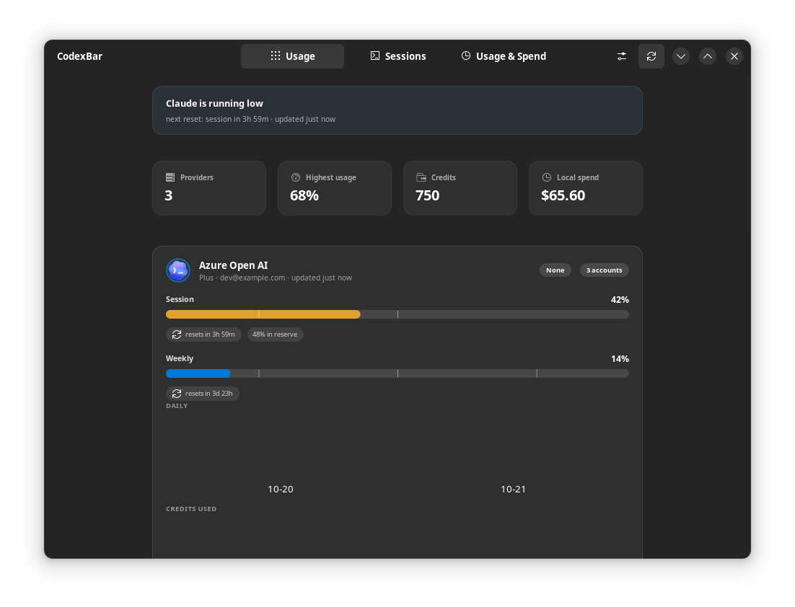
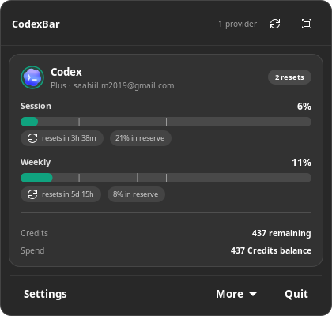
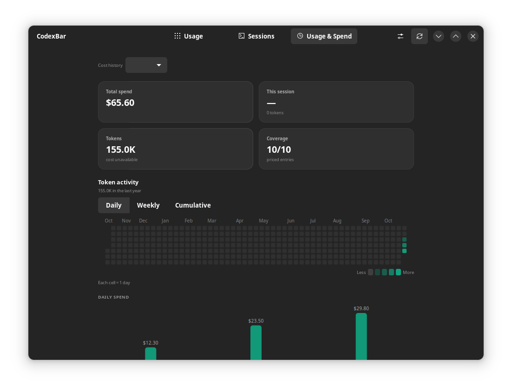
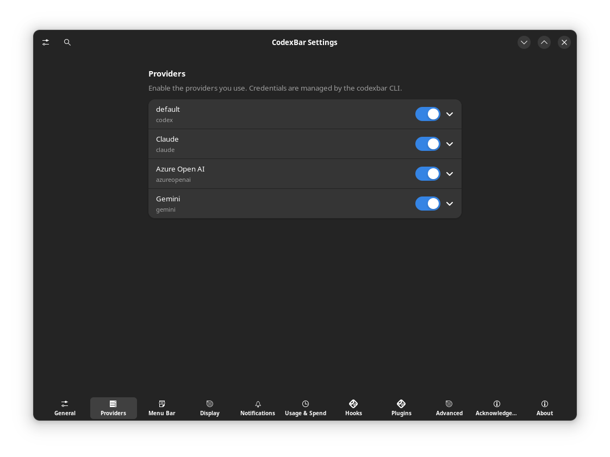

# CodexBar GTK

A native **GTK4 / libadwaita** front-end for the
[CodexBar](https://github.com/steipete/CodexBar) CLI — the menu-bar app that shows
how much of your OpenAI Codex, Claude Code and other provider quotas is left, and
when each window resets.

This is a **community front-end**: it adds no provider fetching, no authentication
and no packaging of its own. It consumes the JSON the CodexBar CLI already emits
(`codexbar usage --format json`, `codexbar cost --format json`,
`codexbar sessions --json-v2`), the same way the other community integrations do
(the [Waybar module](https://github.com/Marouan-chak/codexbar-waybar), the
[COSMIC applet](https://github.com/andrew-verde/codexbar-cosmic-applet), the
[Plasma widgets](https://github.com/psimaker/codexbar-plasmoid), …).

## Screenshots



| Compact tray panel | Usage & Spend |
| --- | --- |
|  |  |

| Agent sessions | Provider settings |
| --- | --- |
|  |  |

Screenshots use synthetic fixture data and do not show real account information.

## What it does

- **A system tray meter** that fills with the provider's accent colour and turns
  amber or red near the limits, plus a host-rendered menu with the live usage of
  every provider. Hover shows the selected provider and its named quota windows;
  right-click opens an action panel with refresh, update check, restart, Settings
  and quit.
- **A compact panel** anchored above the panel, with one card per provider:
  quota meters per window (session / weekly / …), reset countdowns, pace
  ("12% in reserve"), credits and spend. Provider cards use upstream CodexBar
  artwork where available, with a readable initial fallback when a logo is
  unavailable.
- **A dashboard** with a summary strip, provider cards, an agent-sessions page and
  a Usage & Spend page with a daily chart and a per-provider breakdown.
- **A preferences window** covering the refresh interval, providers, display
  options, quota notifications, spending and the tray.
- **Desktop notifications** when a provider crosses a warning threshold, when the
  current pace depletes a quota before its reset, and when a rate limit reset
  credit is about to expire.

## Requirements

- Linux with a Wayland or X11 session (developed against KDE Plasma 6 / Wayland)
- Python 3.10+, GTK 4 and libadwaita 1.4+
- The `codexbar` CLI (0.79 or newer; newer provider data is optional)

## Install

```sh
git clone https://github.com/SaahiilM/codexbar-gtk.git
cd codexbar-gtk
./scripts/bootstrap-deps.sh    # only if the Gtk-4.0/Adw-1 typelibs are missing
./scripts/install.sh           # launcher, icon, systemd user service, autostart
~/.local/bin/codexbar-gtk
```

`bootstrap-deps.sh` fetches the GTK4 introspection data into a private prefix
without root. If your distribution ships it, install it directly instead:

```sh
sudo apt install gir1.2-gtk-4.0 gir1.2-adw-1 python3-gi-cairo
```

Useful flags:

```sh
codexbar-gtk            # start the app
codexbar-gtk --panel    # start it with the compact panel open
codexbar-gtk --settings # start it and open the settings
codexbar-gtk --page sessions|spend
```

Uninstall with `./scripts/install.sh --uninstall`.

## How it talks to CodexBar

| Command | Used for |
| --- | --- |
| `codexbar usage --format json` | provider usage, credits, pace, status, detail sections and charts |
| `codexbar usage --provider X --all-accounts` | the account list for a provider |
| `codexbar cost --provider both --format json` | local spend, projects and models |
| `codexbar sessions --json-v2` | the running coding agents |
| `codexbar config providers` | the provider list in Settings |
| `codexbar config enable/disable/set-source/set-api-key` | provider management |
| `codexbar hooks list`, `codexbar plugins list` | the Hooks and Plugins panes |

Point the app at a different binary with `CODEXBAR_CLI=/path/to/codexbar` or in
Settings → Advanced → CLI path.
The provider catalog, fetching, and credential handling follow the installed
CLI; new providers appear here when that CLI version supports them.
The GTK client supports older CLI releases; newer providers and quota fields
are optional. Missing cost estimates display as unavailable, not zero; if a
cost refresh fails, the previous totals remain visible as a marked known
subtotal until a successful refresh. The tray's update check fetches only the
public client `VERSION` marker from GitHub; it does not install or download code.

## Incremental Rust port

The application remains primarily Python. The Rust core is being integrated one
module at a time behind an opt-in PyO3 extension. The live Rust paths currently
cover provider metadata (canonical IDs, names and colors), Usage & Spend
activity helpers, display formatting, monthly allowance daily targets, quota
history storage and queries, sparkline geometry, and the first typed payload
primitives from `data.py` (UTC timestamp parsing, numeric validation and
`RateWindow`, `Pace`, `CostInfo`, detail chart, provider summary and session
derived values, plus standard quota-window, extra rate-window, provider cost, detail chart,
provider context (credits/status/error/plan), agent-session and spend payload
normalization). GTK rendering and the rest of CLI/provider payload normalization
remain in Python/the CodexBar CLI. The client targets upstream
CodexBar 0.82.0 provider behavior; the provider catalog remains at 110 providers.

### Native Rust migration roadmap

The approved destination is a **fully native Rust GTK4/libadwaita app**, with the
backend migrated **before** the UI. The PyO3 bridge and Python shell are
temporary. Backend gate BG passed in PR #54. U01's native bootstrap merged in
PR #56; the remaining Phase U screens are still pending.

- [Architecture, source inventory and stage gates](docs/rust-migration/README.md)
- [Task checklist and current model handoff](docs/rust-migration/TASKS.md)
- [Decisions, verification evidence and audit trail](docs/rust-migration/AUDIT.md)

Future coding agents should start with [`AGENTS.md`](AGENTS.md). B00–B15 and BG
are accepted. U01's build-55 native application/bootstrap is merged at
`3eea06f`; U02 is the next Phase U task for orchestration to coordinate. The
Python launcher remains default until the UG cutover gate passes. See E086 for
the BG merge, B11 CI limitation and B15 compatibility bounds.

### Existing opt-in module integrations

- [x] `providers.py` metadata — Rust-backed in opt-in mode.
- [x] `activity.py` — spend series and heatmap calculations, Rust-backed in
  opt-in mode.
- [x] `format.py` — UTC-compatible display formatters, Rust-backed in opt-in
  mode; naive and non-UTC datetimes retain the Python behavior.
- [x] `pace.py` — monthly allowance calculations and daily-target formatting,
  Rust-backed in opt-in mode; currency conversion remains in Python.
- [x] `history.py` — JSON-lines persistence, retention, caching, and sorted
  quota-history queries, Rust-backed in opt-in mode. Existing files work with
  either backend; unsupported sample inputs retain the Python path.
- [x] `charts.py` — time-spaced sparkline coordinates and fixed quota axes,
  Rust-backed in opt-in mode; GTK/Cairo drawing remains in Python.
- [x] `data.py` — timestamp/numeric primitives, standard quota-window, pace,
  extra rate-window, provider cost, detail chart, provider context
  (credits/status/error/plan), and agent-session payload normalization are
  Rust-backed in opt-in mode (B01a–c/B02a–b2b2b/B03); spend normalization
  (B04) and B13–B15 transitional backend work are complete. GTK widgets and
  platform integration remain in Python until their native UI tasks are accepted.

The six original Rust ports have opt-in runtime integrations, with additional
`data.py` behavior routed through Rust in opt-in mode. This checklist
is not the full backend/native migration checklist above. Python implementations
remain available as parity references until the backend, native UI and cutover
gates are passed; the application is not yet entirely Rust. BG has passed; the
UI gate and cutover gate remain open.

Build the extension and opt in for the app process with:

```sh
./scripts/build-rust-core.sh
CODEXBAR_RUST_CORE=1 ./run.sh
```

Python remains the default when the environment flag is absent. Explicitly
setting the flag fails fast if the extension is unavailable. See the
[Rust-core migration notes](rust-core/README.md) for implementation and test
details. The screenshots above were captured from the Rust-enabled UI with
fixture CLI data.

## Feature parity with the macOS app

| Upstream area | Here |
| --- | --- |
| Menu bar item, merged icons, icon styles | StatusNotifierItem with a meter or an icon+percentage pixmap |
| Tray hover and context menu | Explicit client/provider/window tooltip; right-click actions for refresh, update check, restart, Settings and quit |
| Automatic quota lane | Tray option "the quota running out soonest", ranked like the macOS Auto lane: a fully depleted quota first, then the smallest forecast ETA |
| Provider cards, meters, reset countdowns | One card per provider with a meter per window, countdown chip and pace chip |
| Pace forecast | "12% in reserve" / "in deficit" chips, colour coded |
| Monthly allowance target | Daily-use target in the quota's own units, divided across remaining local calendar days |
| Predictive pace warnings | Desktop notification when the current pace depletes a Codex or Claude quota before its reset — once per reset cycle |
| Quota burndown | Projected usage at reset, extrapolated from the recorded history |
| Weekly work-day progress | Work-day tick on the weekly meter |
| Limit Reset Credits | A "3 available · 4h 39m · 7d 2h" badge with every credit's expiry on hover, and an alert when a credit expires within 3 days |
| Usage breakdown / credits history charts | Rendered from the CLI's `usage.details[].chart` and `credits.events` |
| Cost history / spend dashboard | Usage & Spend page with daily chart, projects, models and a per-provider breakdown |
| Token activity heatmap | A 12-month daily/weekly/cumulative heatmap built from `cost --json` daily token totals, with per-day tooltips |
| Preferred currency | Converts spend totals with daily exchange rates (cached 24 h) and offline fallbacks; "Automatic" keeps the reported currency |
| Statistics time zone | "Daily buckets" picker passes `TZ` to the CLI so day boundaries move with the chosen zone |
| Usage history sparkline | The recorded quota history over the last 24 h on each card (macOS live tokens-per-minute requires OpenAI's live API and is not fetched) |
| Provider status badges | Status dot and description per provider |
| Provider accounts | Account list per provider via `--all-accounts` |
| Agent sessions | Sessions page listing the running coding agents |
| Quota notifications, hooks, plugins | Notifications pane, Hooks pane and Plugins pane backed by the CLI |
| Preferences panes | General, Providers, Menu Bar, Display, Notifications, Usage & Spend, Hooks, Plugins, Acknowledgements, Advanced, About |

Still macOS-only upstream and therefore absent here: iCloud fleet sync, widgets,
window-focus for sessions, managed account profiles, browser credential import,
the menu-bar layout editor, remote sessions over Tailscale/SSH and the
`codexbar serve` HTTP backend (this front-end reads local CLI JSON directly).

## Versioning

The GTK front-end uses the same version pair as the macOS bundle:

* `MARKETING_VERSION` in [`VERSION`](VERSION) is the upstream CodexBar release
  this client is feature-compatible with (`0.82.0`).
* `CURRENT_PROJECT_VERSION` is the build number of the Linux front-end.
* `codexbar_gtk/version.py` turns the pair into the macOS-style
  `"0.82.0 (58)"` string shown under Settings → About, in the tray menu and by
  `./run.sh --about`.

Increment `CURRENT_PROJECT_VERSION` for each merged PR and keep it in sync with
`BUILD` in `codexbar_gtk/version.py`; the test suite fails if the two drift.
`MARKETING_VERSION` only changes when the supported upstream CodexBar release
changes. [`CHANGELOG.md`](CHANGELOG.md) records the changes in each build.

## Development

The headless Rust service contract is being introduced in `rust-backend/`.
It uses Tokio for async work, keeps GTK outside the backend crate, and publishes
latest-value snapshots through a watch channel. This is migration scaffolding;
the existing application still runs its Python backend by default, while the
Rust opt-in routes refresh polling and typed notification events through the
Rust controller and uses existing PyO3 module integrations for other ports.

```sh
./run.sh                                  # run from the checkout
python3 -m unittest discover -s tests -v  # the test suite
./tools/preview.py /tmp/preview           # render UI widgets with local state
```

### GTK4 / libadwaita typelibs

On Ubuntu/KDE neon, install the system packages (no-root alternative below):

```sh
sudo apt update
sudo apt install python3-gi python3-cairo gir1.2-gtk-4.0 gir1.2-adw-1 libadwaita-1-0
```

Verify the same Python interpreter used by the app can import both namespaces:

```sh
python3 - <<'PY'
import gi
gi.require_version("Gtk", "4.0")
gi.require_version("Adw", "1")
from gi.repository import Gtk, Adw
print("GTK", Gtk.get_major_version(), "ready; libadwaita ready")
PY
```

Without root access, run `./scripts/bootstrap-deps.sh`. It downloads and unpacks
the typelibs/runtime libraries into the ignored local `.deps/` directory; `run.sh`
and `tools/preview.py` add those paths automatically. Do not commit `.deps/`.
The preview needs a working X11/Wayland display; use `xvfb-run -a` for a virtual
X display if available. The `offscreen` GDK backend is not included in every GTK
build. Use synthetic CLI data when capturing previews.

### Native Rust GTK bootstrap

U01 adds a separate native bootstrap binary. It talks directly to
`rust-backend`, owns no Python bridge, and keeps screen implementations marked
as placeholders until their U02–U08 slices land. The Python launcher remains
the default until the UG cutover gate passes.

Native builds need GTK development metadata and headers in addition to Python
typelibs:

```sh
sudo apt install libgtk-4-dev libadwaita-1-dev
cargo run --manifest-path rust-gtk/Cargo.toml --locked -- --page usage
```

The CI workflow installs these development packages and exercises initial and
secondary-instance routing plus cancellation during an in-flight synthetic
CLI request. A synthetic Wayland bootstrap capture is in
[`docs/rust-migration/screenshots/u01-native-bootstrap-wayland.png`](docs/rust-migration/screenshots/u01-native-bootstrap-wayland.png).

To exercise the Rust-backed paths, build the optional PyO3 extension and run
the test suite with both implementations:

```sh
./scripts/build-rust-core.sh
python3 -m unittest discover -s tests -v
CODEXBAR_RUST_CORE=1 python3 -m unittest discover -s tests -v
```

The Rust backend is opt-in; without the flag, the app continues to use Python.

The tests never touch a real provider account: the CLI is faked and the payloads
are recorded fixtures. Tray signal tests use a private D-Bus session and require
`dbus-run-session`, `dbus-python`, and PyGObject; they skip when those optional
dependencies are absent. CI installs them and runs those tests separately.

## Licence

MIT, like the upstream project.
